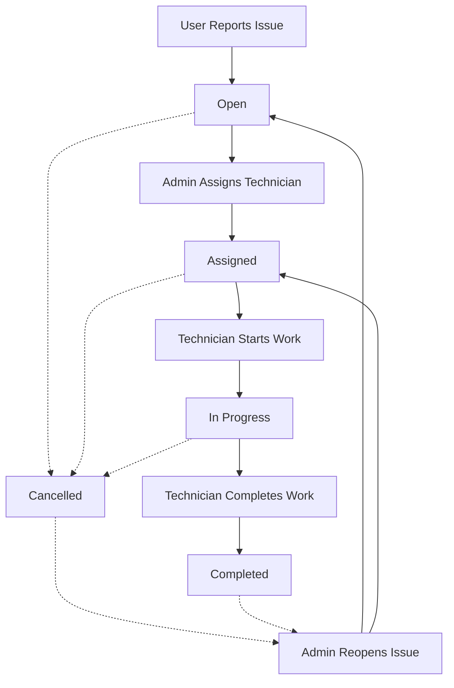
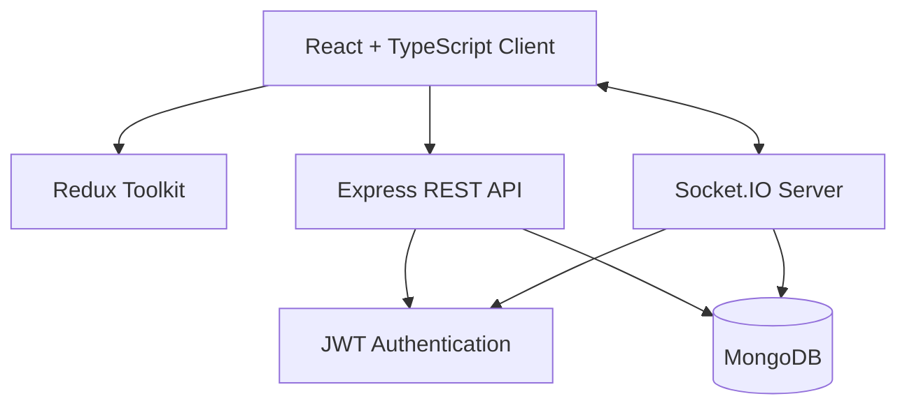

<div align="center">


### Maintenance Request & Workflow Management Platform

A modern, real-time maintenance management platform designed to simplify issue reporting, technician assignment, and maintenance operations.

**From the first report to the final resolution — all in one place.**

<p>
  
  
  
  
</p>

</div>

---

# 📖 About FixFlow

**FixFlow** is a centralized maintenance request and workflow management system that connects users, administrators, and technicians through a single platform.

It replaces scattered messages, manual tracking, and disconnected maintenance records with a structured workflow.

Users can report maintenance problems, administrators can organize and assign tasks, and technicians can manage their assigned work efficiently.

With **real-time updates, role-based permissions, notifications, and maintenance history**, FixFlow keeps everyone informed throughout the entire process.

### Why FixFlow?

- Centralized maintenance request management
- Clear responsibility and task ownership
- Faster communication between departments
- Real-time status updates
- Organized maintenance history
- Better visibility into operational performance
- Simple and responsive user experience

---

# ✨ Features

### 👤 User Workspace

- Secure account registration and login
- Create maintenance requests
- Provide issue descriptions and locations
- Select maintenance categories
- View submitted requests
- Track issue status
- Receive maintenance notifications
- Follow the resolution process

### 🛡️ Administration Dashboard

- Centralized maintenance control panel
- View and manage reported issues
- Assign and reassign technicians
- Update issue priorities
- Cancel and reopen maintenance requests
- Filter issues by status, priority, category, and technician
- Search and navigate paginated issue lists
- Manage users and account roles
- Monitor operational statistics
- Receive live issue updates

### 🔧 Technician Workspace

- View assigned maintenance requests
- Access detailed issue information
- Start maintenance work
- Mark completed tasks
- Add public comments
- Create internal maintenance notes
- Follow permitted workflow transitions
- Receive assignment and status notifications
- Access automatically updated task lists

### 🔔 Real-Time Notifications

- Instant maintenance event updates
- Technician assignment notifications
- Status change notifications
- Comment notifications
- Persistent notification history
- Read and unread notification tracking
- Automatic data synchronization through Socket.IO

---

# 🛠️ Technology Stack

<div align="center">


</div>

| Layer | Technology |
| --- | --- |
| Frontend | React + TypeScript |
| Build Tool | Vite |
| Routing | React Router |
| State Management | Redux Toolkit |
| HTTP Client | Axios |
| Backend | Node.js + Express |
| Database | MongoDB |
| ODM | Mongoose |
| Real-time Communication | Socket.IO |
| Authentication | JWT + bcrypt |
| Validation | Zod |
| Code Quality | ESLint |
| Version Control | Git + GitHub |

---

# 🔄 Maintenance Workflow

FixFlow follows a clear maintenance lifecycle.



### Workflow Stages

| Status | Description |
| --- | --- |
| `open` | The maintenance request has been created |
| `assigned` | A technician has been assigned |
| `in_progress` | The technician is working on the issue |
| `completed` | The maintenance task has been completed |
| `cancelled` | The issue has been cancelled |

Every permitted status transition is recorded to maintain a clear maintenance history.

---

# 👥 Role-Based Access

FixFlow provides three primary roles.

| Capability | User | Technician | Admin |
| --- | :---: | :---: | :---: |
| Create maintenance requests | ✅ | — | — |
| View own requests | ✅ | — | — |
| View assigned requests | — | ✅ | — |
| Update technician workflow | — | ✅ | — |
| Add maintenance comments | — | ✅ | — |
| Add internal notes | — | ✅ | — |
| Assign technicians | — | — | ✅ |
| Manage priorities | — | — | ✅ |
| Manage users and roles | — | — | ✅ |
| View administration statistics | — | — | ✅ |
| Receive notifications | ✅ | ✅ | ✅ |

Authorization is enforced by the backend to protect restricted operations.

---

# 🧱 System Architecture



### Frontend

The React application provides dedicated interfaces for users, technicians, and administrators.

Redux Toolkit manages application data, while Axios handles API requests.

### Backend

The Express API manages authentication, authorization, request validation, and maintenance workflows.

### Database

MongoDB stores accounts, maintenance requests, categories, comments, notifications, and status history.

### Real-Time Layer

Socket.IO synchronizes changes across connected clients using authenticated user sessions and event-driven communication.

---

# 📂 Project Structure

```text
FixFlow/
│
├── client/
│   ├── src/
│   │   ├── app/
│   │   ├── components/
│   │   ├── features/
│   │   │   ├── auth/
│   │   │   ├── admin/
│   │   │   ├── technician/
│   │   │   └── notifications/
│   │   ├── pages/
│   │   └── lib/
│   ├── .env.example
│   └── package.json
│
├── server/
│   ├── src/
│   │   ├── config/
│   │   ├── controllers/
│   │   ├── middleware/
│   │   ├── models/
│   │   ├── routes/
│   │   ├── services/
│   │   ├── sockets/
│   │   ├── validators/
│   │   └── scripts/
│   ├── .env.example
│   └── package.json
│
├── package.json
└── README.md
```

---

# 🚀 Getting Started

### Prerequisites

Before running FixFlow, make sure you have:

- Node.js 22.12 or newer
- npm
- MongoDB or MongoDB Atlas
- Git

MongoDB transactions require a replica set or a compatible MongoDB Atlas deployment.

### 1. Clone the Repository

```bash
git clone https://github.com/Mead-sbait/FixFlow.git
cd FixFlow
```

### 2. Install Dependencies

```bash
npm ci
npm run install:all
```

### 3. Configure Environment Variables

Create local configuration files from the provided examples.

**Backend — `server/.env`**

```env
PORT=3000
MONGODB_URI=mongodb://127.0.0.1:27017/fixflow
JWT_SECRET=replace-with-a-secure-random-secret
JWT_EXPIRES_IN=1h
CLIENT_ORIGIN=http://localhost:5173
```

**Frontend — `client/.env`**

```env
VITE_API_URL=http://localhost:3000/api
VITE_SOCKET_URL=http://localhost:3000
```

Use private environment variables for credentials and server-side secrets.

### 4. Initialize the Database

```bash
npm run seed --prefix server
```

The seed script initializes the default maintenance categories.

For initial administrator provisioning, configure `ADMIN_EMAIL` and `ADMIN_PASSWORD` in the backend environment before running the seed command.

### 5. Run FixFlow

```bash
npm run dev
```

| Service | Local URL |
| --- | --- |
| Frontend | http://localhost:5173 |
| Backend API | http://localhost:3000/api |
| Health Check | http://localhost:3000/api/health |

### 6. Run the Tests

```bash
npm test
```

Runs the client unit tests (vitest) and the server unit tests (node:test). Neither needs MongoDB running.

---

---

# 🔌 API Overview

### Authentication

| Method | Endpoint | Description |
| --- | --- | --- |
| POST | `/api/auth/register` | Register an account |
| POST | `/api/auth/login` | Authenticate a user |
| GET | `/api/auth/me` | Retrieve current account |

### Maintenance Requests

| Method | Endpoint | Description |
| --- | --- | --- |
| POST | `/api/issues` | Create a maintenance request |
| GET | `/api/issues` | Retrieve the user's requests |
| GET | `/api/issues/:id` | Retrieve request details |
| GET | `/api/categories` | Retrieve maintenance categories |

### Administration

| Method | Endpoint | Description |
| --- | --- | --- |
| GET | `/api/admin/issues` | List and filter requests |
| PATCH | `/api/admin/issues/:id/assign` | Assign or reassign a technician |
| PATCH | `/api/admin/issues/:id/priority` | Update issue priority |
| PATCH | `/api/admin/issues/:id/status` | Cancel or reopen an issue |
| GET | `/api/admin/technicians` | Retrieve available technicians |
| GET | `/api/admin/users` | Manage account listings |
| PATCH | `/api/admin/users/:id/role` | Update account roles |
| GET | `/api/admin/stats` | Retrieve maintenance statistics |

### Technician

| Method | Endpoint | Description |
| --- | --- | --- |
| GET | `/api/technician/issues` | List assigned issues |
| GET | `/api/technician/issues/:id` | View assigned issue details |
| PATCH | `/api/technician/issues/:id/status` | Update maintenance status |
| GET | `/api/technician/issues/:id/comments` | View comments and notes |
| POST | `/api/technician/issues/:id/comments` | Add a comment or note |

### Notifications

| Method | Endpoint | Description |
| --- | --- | --- |
| GET | `/api/notifications` | Retrieve account notifications |
| PATCH | `/api/notifications/:id/read` | Mark a notification as read |

Protected endpoints require a valid JWT bearer token.

---

# ⚡ Real-Time Events

FixFlow uses Socket.IO for real-time communication.

| Event | Description |
| --- | --- |
| `issue:created` | A new maintenance request is created |
| `issue:assigned` | A technician is assigned or reassigned |
| `issue:updated` | Maintenance issue information changes |
| `comment:added` | A maintenance comment is added |
| `notification:new` | A new user notification is available |

Socket.IO clients authenticate during the connection handshake.

---

# 🔐 Security

FixFlow incorporates security measures across the application:

- JWT-based authentication
- Password hashing with bcrypt
- Server-side role authorization
- Protected API endpoints
- Request validation with Zod
- Resource ownership checks
- Restricted internal maintenance notes
- Authenticated Socket.IO connections
- User-specific notification access
- Environment-based secret management
- Transaction-based workflow updates

Sensitive credentials must never be committed to the repository.

---

# 📊 Maintenance Statistics

The administration dashboard provides insight into maintenance operations, including:

- Total maintenance requests
- Open requests
- Assigned requests
- Tasks in progress
- Completed requests
- Cancelled requests
- Urgent and unassigned workloads
- Requests by category
- Active tasks by technician

Statistics help administrators understand maintenance workload and prioritize operational decisions.

---

# 👥 Development Team

FixFlow was developed through collaborative full-stack engineering, with clearly defined responsibilities.

| Member | Role | Main Responsibilities |
| --- | --- | --- |
| [Mead](https://github.com/Mead-sbait) | Team Lead | Platform integration, authentication, and user reporting |
| [Karam](https://github.com/karam979) | Full-Stack Developer | Administration dashboard, assignment, user management, and statistics |
| [Mohammad](https://github.com/MDBASHERx) | Full-Stack Developer | Technician workflow, comments, notifications, and real-time communication |

---

# 🌍 Deployment

FixFlow uses a React frontend and a Node.js/Express backend, with MongoDB for persistent data and Socket.IO for real-time communication.

For a production deployment:

- Serve the frontend over HTTPS.
- Configure a publicly accessible API endpoint.
- Use secure server environment variables.
- Configure MongoDB Atlas or a properly secured replica set.
- Set the permitted frontend origin.
- Enable HTTPS/WSS support for Socket.IO.
- Run the compiled backend using the production start command.

Build the application:

```bash
npm run build
```

Start the backend:

```bash
npm run start --prefix server
```

---

# 📚 Project Purpose

FixFlow is designed to make maintenance operations more organized, transparent, and efficient.

By bringing reporting, assignment, technician workflows, and operational tracking together, the platform provides a consistent process from issue creation to resolution.

<div align="center">

---

### FixFlow

**Report Smarter · Assign Faster · Resolve Better**

Built with React, TypeScript, Node.js, MongoDB, and Socket.IO.

</div>
